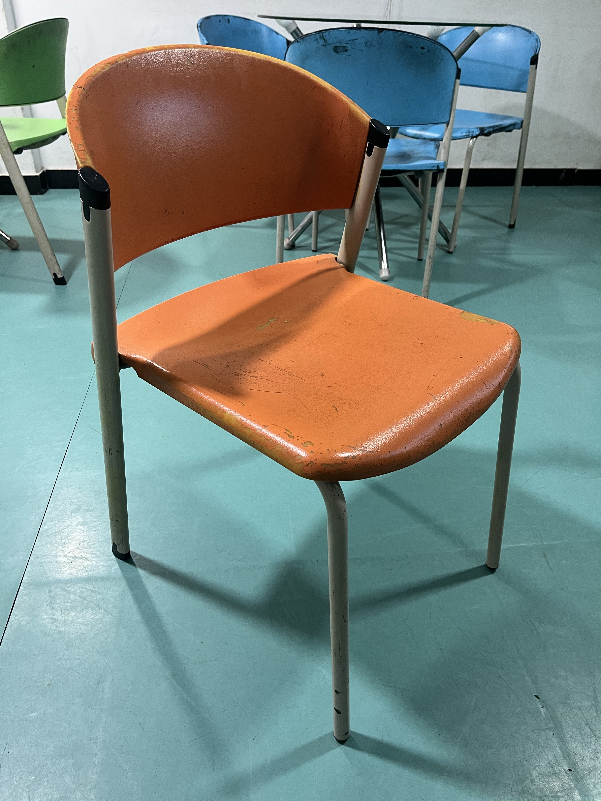
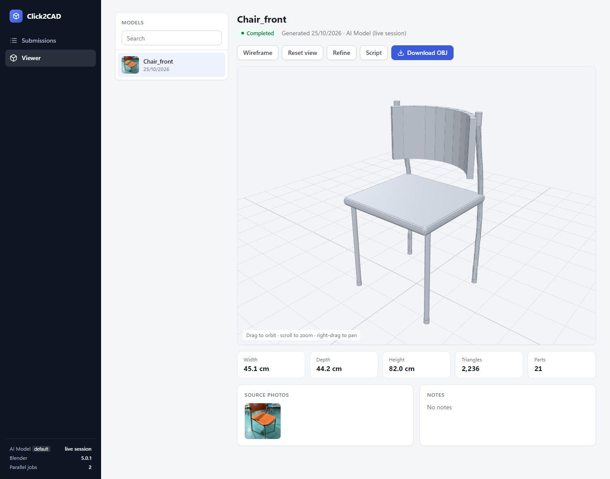
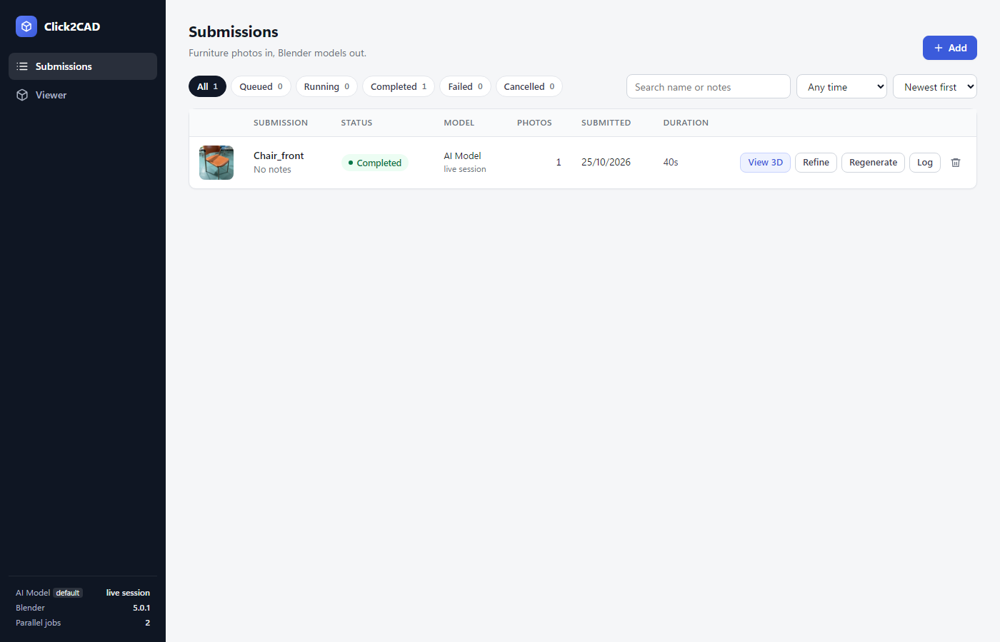

# Click2CAD (Claude + Blender)

Turn furniture photos into 3D models, with **Claude** as the modeller.

Upload a photo of a chair, table or sofa. Claude studies it and writes a Blender Python script. Blender builds the geometry, and you get an OBJ you can orbit in the browser or download. If the result is off, describe what's wrong and Claude rewrites the script.

| Photo in | 3D model out |
| :---: | :---: |
|  |  |

## Screenshots

**Submissions**: every job with its status, model, duration and actions (View 3D, Refine, Regenerate, Log).



**Viewer**: orbit, zoom and pan the model, toggle wireframe, view the generated script, refine it, or download the OBJ. Size, triangle count and part count are shown underneath, next to the source photo.


## How it works

1. **Claude writes a script.** It looks at your photo(s) and writes a `bpy` script using the **parts kit**: helpers (`box`, `rod`, `tube`, `sheet`, `bevel`) that place every part from shared measurements, so attached parts meet and nothing floats.
2. **Blender builds it.** The script runs in the `bpy` Python module. No Blender install is needed. Each job runs in its own process, so a bad script can't take the server down.
3. **You see the result.** The model is exported as OBJ and shown in the in-browser 3D viewer.
4. **Refine if needed.** Describe the problem and Claude rewrites the script.

## Architecture

```
Browser (web/)                      FastAPI server (click2cad/server.py)
  app.js    Submissions, Add, Refine   REST API: /api/jobs, /refine, /retry ...
  viewer.js 3D OBJ viewer              serves model.obj and thumbnails
        │  HTTP                          │
        ▼                                ▼
          JobStore (jobs.py)  ──  SQLite  data/click2cad.db
                              ──  job folders  data/jobs/<id>/
                    │
          JobRunner (runner.py)   background thread, up to 2 jobs at once
                    │  one subprocess per job
                    ▼
          python -m click2cad.pipeline <job_dir>      (pipeline.py)
            1. llm.py asks the model for a Blender script
                 claude.py          api mode: Anthropic API
                 claude_session.py  live mode: Claude Code session
            2. the script runs inside bpy with the parts kit (kit.py)
            3. model.obj is exported
```

### Life of a job

1. **Upload.** `POST /api/jobs` validates the photos, creates `data/jobs/<id>/` with the photos in `inputs/` and a thumbnail, and adds a `queued` row to SQLite.
2. **Queue.** `JobRunner` claims queued jobs while fewer than `C2C_MAX_PARALLEL_JOBS` are running and starts `python -m click2cad.pipeline <job_dir>` for each.
3. **Ask Claude.** The pipeline sends the photos, your notes and the parts-kit rules to Claude. The reply is a Blender Python script. `llm.py` strips markdown fences and makes sure the script ends with the OBJ export.
4. **Build.** Blender is reset to an empty scene and the script runs with `bpy`, `OUTPUT_PATH` and the kit helpers in scope. If the script forgets to export, the pipeline exports the OBJ itself.
5. **Track progress.** The worker prints `@@stage:`, `@@model:` and `@@error:` lines. The runner copies the output to `log.txt` and updates the job in SQLite, which the UI polls. Exit code 0 means `completed`; anything else, a timeout or a cancel ends the job as `failed` or `cancelled`.
6. **View.** The Viewer loads `model.obj` and shows its size, triangle count and part count.

### Live vs API backend

`llm.generate` has two interchangeable backends, chosen by `C2C_CLAUDE_MODE`:

- **api** (`claude.py`): a direct Anthropic API call with the photos attached.
- **live** (`claude_session.py`): the job writes `request.md` and waits for `answer.py`. A Claude Code session running `tools/watch_requests.py` sees the waiting job, reads the photos, writes `answer.py`, and the pipeline continues as normal.

### The parts kit

The prompt forces Claude to define named key dimensions first (seat height, leg radius and so on), then build every part from those variables with `box`, `rod`, `tube`, `sheet` and `bevel`. It may not use `bpy.ops` primitives, object scale or rotation, or boolean modifiers. Attached parts therefore meet at shared coordinates, so legs reach the seat and nothing floats.

### Refine

`POST /api/jobs/{id}/refine` creates a new job linked to the old one. It stores your feedback and the previous script as `base_script.py`, and the pipeline runs in `refine` mode: Claude gets the old script, the photos and your feedback, and returns a corrected script. Refine, Regenerate and Retry all reuse the same queue and pipeline.

### Design choices

- **Process per job.** Each job starts from a clean Blender state, and a crashing script can't take the server down.
- **Recovery.** On start, jobs that were running when the server stopped go back in the queue. Each job has a timeout (30 minutes by default).
- **Plain files.** Metadata is in SQLite and everything else (inputs, request, script, OBJ, log) is plain files in the job folder, so any job is easy to inspect.
- **No sandbox.** Generated code runs as ordinary Python, so the server binds to `127.0.0.1` only.

## Quick start (Windows)

You need Python 3.11. `bpy` 5.0 only ships wheels for it.

```powershell
winget install -e --id Python.Python.3.11
py -3.11 -m venv .venv311
.\.venv311\Scripts\pip.exe install --no-cache-dir --default-timeout 120 --retries 10 -r requirements.txt
```

`bpy` is a large download (hundreds of MB). The extra pip flags avoid timeouts and corrupted downloads on slow connections.

Then start the app:

```powershell
.\start.bat
```

The UI opens at **http://127.0.0.1:8001**. Sophos may show a warning page for local sites; click **Continue**.

To start manually or on another port:

```powershell
.\.venv311\Scripts\python.exe serve.py --port 8080 --no-browser
```

## Two ways Claude can run

Set `C2C_CLAUDE_MODE` in `.env` (copy `.env.example`).

| Mode | How it works | Needs |
| --- | --- | --- |
| `live` (default) | A **Claude Code session** next to the app writes each script. Each job writes `request.md` into its folder and waits (status *Asking Claude*) until `answer.py` appears. | An open Claude Code session that is watching |
| `api` | The Anthropic API writes each script. | `ANTHROPIC_API_KEY` from the Claude Console |

### Live mode runbook

1. Run `start.bat`.
2. In the Claude Code session, ask Claude to **start watching Click2CAD**. It runs `tools\watch_requests.py` in the background and is alerted when a job is waiting.
3. Upload photos with **+ Add**. A job shows *Running · Asking Claude* while Claude works, then the model appears in Submissions and the Viewer. In a test run a single chair took about 40 seconds. Allow longer for complex pieces.
4. Use **Refine** the same way. Refinements are answered live too.
5. When finished, ask Claude to stop watching and close the server window.

If nobody is watching, jobs wait and fail after `C2C_JOB_TIMEOUT_SECONDS` (default 30 minutes). Use **Retry** once Claude is watching again.

## Using the app

- **Add photos**: **+ Add** accepts JPG, PNG or WebP up to 25 MB. *Separate* makes one job per photo. *Multi-view* makes one job from several photos of the same piece. One or two photos at a time works best.
- **Notes**: add a short prompt (for example "seat height 45 cm") to guide Claude.
- **Viewer**: drag to orbit, scroll to zoom, right-drag to pan. **Wireframe** shows the mesh, **Script** shows the generated Blender code, **Download OBJ** saves the model.
- **Refine / Regenerate / Retry**: fix a result, redo it from scratch, or re-run a failed job.

## Configuration

Settings go in `.env` (see `.env.example`). It is re-read for every job, so changes apply without restarting the server.

| Variable | Meaning |
| --- | --- |
| `C2C_CLAUDE_MODE` | `live` (default) or `api` |
| `ANTHROPIC_API_KEY` | api mode only |
| `CLAUDE_MODEL` | api mode only, default `claude-opus-5` |
| `CLAUDE_EFFORT` | api mode only: `low` to `max`, default `high` |
| `C2C_MAX_PARALLEL_JOBS` | jobs running at the same time (default 2) |
| `C2C_JOB_TIMEOUT_SECONDS` | a job running longer is stopped and marked failed (default 1800) |

## HTTP API

The UI is a thin client over a small JSON API:

| Endpoint | Purpose |
| --- | --- |
| `GET /api/config` | providers, Blender version, parallel job limit |
| `GET /api/jobs` | list jobs |
| `POST /api/jobs` | submit photos (`files`, `mode`, `name`, `prompt`) |
| `GET /api/jobs/{id}` | one job |
| `GET /api/jobs/{id}/log` | job log |
| `POST /api/jobs/{id}/refine` | ask Claude to change a finished model |
| `POST /api/jobs/{id}/retry` | re-run a job |
| `POST /api/jobs/{id}/cancel` | cancel a job |
| `DELETE /api/jobs/{id}` | delete a job |

Example:

```bash
curl -F "files=@samples/Chair_front.jpg" http://127.0.0.1:8001/api/jobs
```

## Folder layout

```
click2cad/          Python package
  llm.py              instructions for Claude (parts-kit rules): generate and refine
  kit.py              the parts kit the scripts build with
  claude_session.py   live mode: hand the request to the Claude Code session and wait for answer.py
  claude.py           api mode: Anthropic API call
  pipeline.py         runs one job: Claude -> bpy script -> Blender -> OBJ
  jobs.py, runner.py, server.py, config.py   job records, queue, web API, settings
tools/
  watch_requests.py   live mode: exits as soon as a job is waiting for Claude
  check_script.py     test-build a script, check for floating parts, render review views
web/                browser UI
docs/screenshots/   images used in this README
samples/            example photo
data/               created at runtime: click2cad.db and jobs/<id>/
                      (inputs, request.md, answer.py, script.py, model.obj, log.txt)
serve.py, start.bat, generate.py
```

## Troubleshooting

- **`pip install` times out or reports a hash mismatch** (usually `bpy`): rerun with `--no-cache-dir --default-timeout 120 --retries 10`, or install the small packages first and `bpy` last.
- **`start.bat` says `.venv311` was not found**: do the Quick start steps first.
- **A job stays on *Asking Claude***: live mode has no watcher. Start one, or switch to `api` mode.
- **Port 8001 is busy**: pass `--port` to `serve.py`.

## Notes

- Generated code runs without a sandbox. Keep the server on `127.0.0.1` (the default).
- Results are a first approximation from photos. Expect to **Refine**: shapes are built from simple parts, and the viewer shows plain grey without colours or materials.
- See [COST_ESTIMATE.md](COST_ESTIMATE.md) for API cost estimates.
